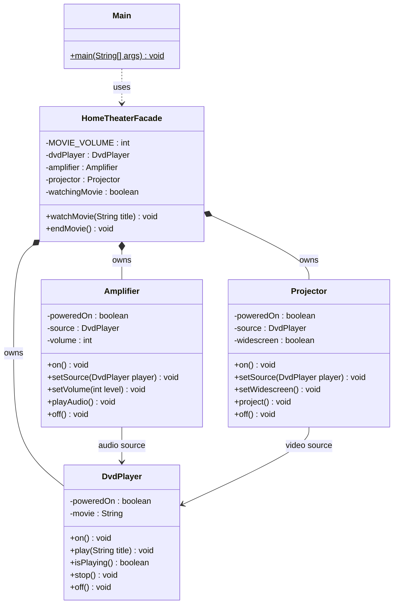

# Assignment 4 Home Theater Facade

## Introduction

Option B models a home theater using a DVD player, amplifier, and projector.
Each component has its own state and setup rules. Audio and projection require
an active DVD source, so starting a movie involves more than switching devices on.
A facade makes this coordinated operation available through one call.
This implementation is a console simulation of those responsibilities.

## UML class diagram



The facade powers the components, connects the DVD player to both output devices,
sets volume and widescreen mode, then starts playback before audio and projection.
Shutdown turns off the outputs before stopping and powering down the source.
The client creates only the facade. No subsystem refers back to it.

## Five Clean Code principles

### 1 Meaningful names

```java
theater.watchMovie(movie); // Names express the client's goal.
theater.endMovie();
```

These names describe the operation without requiring knowledge of device commands.
`watchingMovie` and `MOVIE_VOLUME` also communicate their purpose directly.

### 2 Single Responsibility

```java
dvdPlayer.play(title);    // DVD player owns playback state and validation.
amplifier.playAudio();    // Amplifier owns audio readiness and volume.
projector.project();     // Projector owns projection readiness and aspect ratio.
```

The facade coordinates these calls; it does not implement playback, audio, or
projection rules. Changes to a component's internal rules belong in that component.

### 3 Encapsulation with no subsystem details in the facade API

```java
private final DvdPlayer dvdPlayer = new DvdPlayer(); // Hidden implementation.
public void watchMovie(String title) {              // Only a title is needed.
```

The public API offers only `watchMovie(String)` and `endMovie()`.
It neither returns components nor requires the client to supply them, configure
sources, or choose startup order. Advanced clients can still instantiate the
public subsystem classes themselves.

### 4 Small focused subsystem classes

```java
public boolean isPlaying() {
    return poweredOn && movie != null; // DVD readiness belongs to the DVD player.
}
```

The DVD player manages power and playback. The amplifier manages its audio source
and volume. The projector manages its video source and display mode. Methods are
short and focused, and source readiness is queried rather than copied into the outputs.

### 5 Proper error handling

```java
if (title == null || title.isBlank()) {
    throw new IllegalArgumentException("Movie title must not be blank.");
}
// During coordinated startup:
catch (RuntimeException failure) {
    endMovie(); // Reset all components after a partial startup.
    throw new IllegalStateException("Unable to start the home theater.", failure);
}
```

Input validation happens before devices are changed. Starting a second movie is
rejected until the current one ends. If a subsystem fails during startup, the
facade shuts down the components and preserves the original cause. Shutdown is
safe to repeat because the simulated components reset their state without throwing.
`Main` reports validation/state errors and uses `finally` to shut down the theater.

## Conclusion

The facade hides source wiring, volume and display configuration, power sequencing,
and failure cleanup. The client reduces the operation to starting and ending a
movie. Subsystem methods remain public and independently usable, with no knowledge
of the facade. The design needs only three subsystem classes, one facade, and one client.

## GitHub repository

[SDP_4th](https://github.com/asankhanshyngys/SDP_4th)

## Defense demonstration

Run `Main` to show startup and shutdown; supply a movie title to change the demo.
Run `java -cp out Main " "` to demonstrate input rejection before startup.
Explain why playback precedes audio and projection, why the client knows only
the facade, and why advanced clients retain direct access to the components.
